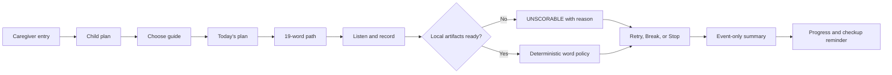

# VaakMitra Android Review APK Design

**Status:** Approved direction consolidated from the 2026-09-15 mobile UI discussion  
**Normative source:** `VAAKMITRA_FINAL_SSOT.md`  
**Applicable decisions:** DEC-012, DEC-013, DEC-014, DEC-019, DEC-020, DEC-021, DEC-025, DEC-026, DEC-027

## Outcome

Produce an installable Android review APK that demonstrates the complete non-clinical product journey on an ordinary Android 10+ ARM64 phone. The APK must remain usable without the development FastAPI server. It must never turn missing mobile inference, calibration, or review artifacts into a fabricated score or PASS.

## End-to-end journey

1. Caregiver opens the app and chooses **Offline review demo** or uses existing backend sign-in.
2. Caregiver completes the local child plan: alias, age 7-14, preferred session duration, focus-block duration, planned breaks, and a motivating interest.
3. Caregiver chooses one of four local expressive guides and a motion level.
4. Home shows the saved plan, a truthful device-readiness banner, the next activity, progress based only on recorded app events, and therapist checkup status.
5. The child opens the 19-word starter path. Every card includes Tamil, readable English transliteration, meaning, and difficulty.
6. Practice shows the selected guide, target word, transliteration, microphone control, and dominant red Break/Stop control.
7. A microphone attempt is locally validated. Until the required mobile INT8 student and matching artifacts are packaged, the decision remains `UNSCORABLE / MODEL_UNAVAILABLE`; capture quality and the attempt event may still be recorded.
8. Break pauses immediately. Stop or finish writes a minimal local session record with no raw audio, transcript, embeddings, or inferred attention/emotion.
9. Session Summary shows duration, attempted words, microphone attempts, breaks, and outcome counts. It explains that no pronunciation score was produced when the scorer was unavailable.
10. Progress aggregates only stored session records. Therapist checkup shows `schedule_unestablished`, `therapist_unassigned`, due, or overdue truthfully; overdue never blocks practice.

## Layouts

### Visual system

DEC-027 adapts the owned [`Ajey95/FSF-95/calm-market`](https://github.com/Ajey95/FSF-95/tree/main/calm-market) language rather than copying its game assets: warm cream surfaces, rounded outlined cards, quiet translucent background forms and gentle press/float feedback. VaakMitra replaces that project's pastel green emphasis with deep maroon primary actions, snuff-brown secondary accents, parchment information panels and dark warm text. Saturated rainbow gradients are removed. Red remains reserved for Break / Stop and destructive session exit.

### Caregiver setup

Scrollable single-column layout: warm heading, child alias and age fields, selectable time chips, interest field, privacy card, then a large **Save plan** action. All touch targets are at least 48 dp.

### Home

Top bar with greeting and profile. A compact readiness banner comes first. The primary card is **Today’s plan** with duration, focus-block/break rhythm and **Start practice**. Secondary two-column actions are Words, Progress, Checkup, and Guide. The red stop control is not shown outside a live session.

### Word path

Vertically scrolling cards with a large Tamil word, English transliteration, meaning and a three-level difficulty label. No stars or mastery claims are generated from difficulty.

### Practice

The selected expressive guide occupies the top third. The target card presents Tamil first and transliteration/meaning second. The microphone is the single primary action. A full-width red **Break / Stop** remains visible at the bottom. Processing and error states freeze nonessential motion.

### Session summary

Clear neutral outcome heading, a 2x2 event-metric grid, a privacy/readiness explanation, **Practice another word**, and **Back home**. `UNSCORABLE` is visually neutral, never punitive.

### Progress and checkup

Progress uses counts and time from stored events only. No demo stars, fake accuracy chart, or “mastered” total. Checkup is a separate caregiver view with due-state explanation and a non-claiming **Prepare booking reminder** action.

## Local data boundary

- DataStore stores the child plan, review-demo identity, avatar preference, checkup schedule metadata, and compact session summaries.
- Raw microphone PCM exists only in memory for the current attempt and is discarded after assessment or cancellation.
- No audio, transcript, embedding, image, video, attention label, diagnosis, or fabricated appointment is stored or uploaded.
- Backend content may refresh the catalogue for authenticated development use, but the canonical local 19-word starter path always remains available.

## Error behavior

- No backend: offline review demo and local navigation continue.
- No microphone permission: explain the missing permission and keep Break/Stop available.
- Invalid/empty capture: record an attempt with the explicit capture reason, not a score.
- No mobile scorer: `UNSCORABLE / MODEL_UNAVAILABLE`, neutral coaching, no PASS/RETRY claim.
- Missing therapist assignment/date: show the matching unknown state, never invent a due date.

## Verification

- JVM tests cover age/time normalization, the exact 19-word catalogue, checkup-state calculation, and event-only session summaries.
- Gradle `testDebugUnitTest`, `lintDebug`, and `assembleDebug` must pass.
- APK path, size, and SHA-256 are recorded after the final build.
- Physical-device microphone, rendering, thermal, latency, and accessibility evidence remains a separate gate unless an Android device is attached.
